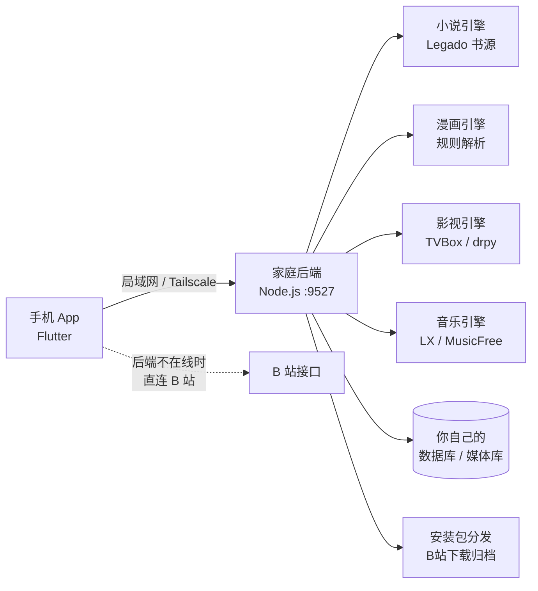

# ThirdHub v4 — 安卓主客户端 + 家庭后端

<p align="center">
  
</p>

<p align="center">
  <b>一个 App，五个板块，自己家的服务器。</b><br>
  小说 · 漫画 · 影视 · 音乐 · B 站，聚合在一个不到 30MB 的安卓客户端里。
</p>

<p align="center">
  <a href="https://thirdhub.pages.dev/download.html"></a>
  
  
  
  
</p>

<p align="center">
  
  
  
</p>

---

## 它是怎么跑起来的



**关键点**：内容解析全在后端，客户端只做界面和播放。
所以换源、修规则、加站点，都不用重新发版 —— 这是它和别的聚合 App 最大的不同。

---

> **一个 App，五个板块，自己家的服务器。**
>
> 小说 · 漫画 · 影视 · 音乐 · B 站，聚合在一个不到 30MB 的安卓客户端里。
> 内容源不在 App 里，而在你自己的 NAS 上 —— 换源不用等新版，改一份配置就生效。
> 没有广告、没有会员墙、不收集数据：所有请求都走你家的机器。

**下载安装**：[thirdhub.pages.dev/download.html](https://thirdhub.pages.dev/download.html)　·　**当前版本**：4.81.119（50790）

---

## 它解决什么问题

市面上的聚合 App，要么源三天两头挂、要么更新一次就得重新装、要么把内容藏在别人服务器上。
这个项目换了个思路：**客户端只做界面和播放，内容解析跑在你自己家的 NAS 上**。

- 源失效了？在 NAS 上换一个，手机端不用重装
- 想加个站点？后端加一个解析器，所有端立刻可用
- 家里没公网 IP？局域网直连，出门用 Tailscale 组网
- 担心数据？数据库在你自己的硬盘上，随手就能备份

## 五个板块

| 板块 | 能做什么 |
|---|---|
| **小说** | Legado 书源直接导入，百万书源生态；书架、阅读进度、字体排版全部本地 |
| **漫画** | 规则引擎解析 + 双指缩放 + 条漫模式；图源失效自动跳过 |
| **影视** | TVBox / drpy 规则，直播与点播并包；播放器支持倍速、手势调亮度音量 |
| **音乐** | LX / MusicFree 音源；歌单、歌词、后台播放 |
| **B 站** | 双列首页、频道切换、弹幕、评论区、点赞投币数据；**后端不在线时 App 直接连 B 站** |

## 三步开始

**1. 起后端**（一台能跑 Docker 的机器，群晖/威联通/软路由都行）

```bash
mkdir -p ~/thirdhub/data && cd ~/thirdhub
docker run -d --name thirdhub-backend --restart unless-stopped --network host \
  -v "$PWD/data:/app/data" ghcr.io/smalluniverseheng/thirdhub-backend:0.8.8
```

**2. 装 App**：到 [下载页](https://thirdhub.pages.dev/download.html) 拿最新安装包（约 30MB，Android 7.0+）

**3. 连起来**：App →「我的 → 我的后端」填 `http://你的NAS地址:9527`，输入后端密钥即可

## 项目结构

```
flutter_app/   Flutter 客户端（Dart，Material 3 + 新拟物主题）
server/        Node.js 后端（四类内容引擎 + B 站桥 + 安装包分发）
```

后端同时是个「家庭服务台」：给 App 发安装包、代理媒体流、收集错误日志、跑定时代理任务。

---

## 给接手的人

下面是从第一行代码写到现在积累的**全部工程细节**：版本口径、四条产品线的区分、每个模块为什么这么写、踩过的坑。
如果只是使用，读到这里就够了；要改代码，请继续往下。


> **本仓就是用户手机上正在用的那条产品线。**
> 客户端包名 `com.thirdhub.app`，当前版本 **4.81.119**（versionCode 50790），安装包约 **195 MB**（**arm64-v8a 单 ABI**）。
> ★体积口径（2026-11-26 改）：4.81.112 起把 **DSH 完全体运行包（ubuntu-base + 官方 node 24 + dsh 0.2.2-rc.1，解压 696 MB）**
> 打进安装包，装完即用、不再依赖首次联网下载 170 MB。代价是包体从 26 MB 涨到约 195 MB。
> ★分发口径：Supabase `downloads` 桶有 **50 MiB 硬上限**（`file_size_limit=52428800`，套餐限制、调不高），
> 故 >45 MB 的包一律**分片**：`thirdhub/parts/<ver>/p1..pN`（40 MB/片）+ 清单 `latest-app.json` 带 `parts[{url,size,sha256}]`；
> 版本化整包与固定别名跳过（塞不进），`url`/`aliasUrl` 指向 ghfast 代理的 Release 资产。
> 端内更新按清单逐片 `curl -C -` 续传到目标 size 后校验 sha256 再合并。
> push 默认只打 `android-arm64`；32 位（armeabi-v7a）按需 `workflow_dispatch abis=android-arm` 出包。
> 仓库名里的 `-v2` 是历史遗留（第二代聚合平台 OmniHub 之后的第二个仓），与版本号 `4.x` 无关 —— 不要按仓名推断版本。

---

## 一、先读这一段：四条产品线，别搞混

本项目同时存在多条 Flutter / Android 产品线，**它们不是同一条线**。
接手前请先确认自己改的是哪一条 —— 曾经有改动落在旁支上、而用户用的是本仓，白做一轮。

| 产品线 | 源码位置 | 仓库 | 包名 | 当前版本 | 体积 | 谁是主力 |
|---|---|---|---|---|---|---|
| **第三方聚合 V4** | `flutter_app/` | **本仓 `ThirdHub-v2`** | `com.thirdhub.app` | **4.81.119** | ~195 MB | **★ 用户在用的主线** |
| Android 轻壳版 | `ThirdHub-Android` | `ThirdHub-Android`（私有） | `com.thirdhub.android` | 3.0.16 | ~10 MB | 备用 |
| 完全体客户端（旁支） | `D:/ai/thirdhub-flutter` | `ThirdHub-Flutter`（私有） | `com.thirdhub.thirdhub_flutter` | 0.4.4 | ~105 MB | **旁支，已搁置** |
| 漫画稳定版（第二代） | `OmniHub-Android` | `OmniHub-Android`（私有） | — | 2.4.0 | ~60 MB | 历史存档 |

**只改 V4，就只碰本仓的 `flutter_app/` 与 `server/`。**

判别技巧（三条里任一条对上就是本仓）：

1. 包名 `com.thirdhub.app`；
2. 安装包约 195 MB（arm64 单 ABI，含 DSH 完全体运行包；轻壳版是 10 MB）；
3. 应用内「检查更新」读的是 Supabase 桶里的 `latest-app.json`（旁支读的是网页端 `app-versions.json`）。

---

## 二、本仓包含什么

```
flutter_app/          ★ V4 主客户端（Flutter 3.47.4）
  lib/main.dart         入口 + 全部模块注册（单文件，约 6300 行）
  lib/core/             80 个模块文件（下节逐类说明）
  android/              Android 工程（Kotlin 侧扩展）
  assets/branding/      品牌图标（与网页端逐字节同源）
  tool/                 纯 Dart 自检脚本

server/               ★ 家庭后端（Node.js ≥ 20，HTTPS :9527）
  index.js              服务入口
  engine*.js            四类内容引擎（详见 §四）
  agent-dsh.js          THA/1 Agent 运行时（DSH）
  agent-profiles.json   Agent 权限档位（服务端权威）
  peer-hub.js           PH/1 端网中枢
  mcp-registry.js       MCP 服务注册表
  routes-*.js           各能力路由
  test_*.cjs            协议自检

plugins/              插件体系
  th-plugin.js          插件 SDK（具名 apply(ctx)，禁 export default）
  example-downloader/   示例插件
  selftest-plugin-e2e.js 真进程端到端自检

docs/                 19 份文档 —— 索引见 §五
deploy/               一键部署（install-linux.sh / install-windows.ps1 / thirdhub.service）
legado-patch/         Legado 零配对补丁（AutoPairer.kt）
tools/                thp-check.js（THP 契约校验）· rebuild-env.sh
build-out/            分模块 changelog 数据（changelog.json / changelog-full.json）

ARCHITECTURE.md       架构总纲
STYLE_GUIDE.md        UI 规范（铁律：禁用 emoji）
```

### `flutter_app/lib/core/` 模块分类（80 个文件）

| 类别 | 文件 |
|---|---|
| Agent / AI | `ai_agent` · `ai_agent_page` · `agent_dsh_client` · `agent_models` · `agent_policy` · `ai` · `ai_page` · `ai_skills` · `ai_store_prefs` · `pro_ai` · `chat` |
| 阅读 | `novel_reader` · `pro_reading` · `reader_fonts` · `read_stats` · `tts` · `tts_presets` · `local_import` |
| 引擎 | `engine_direct` · `engine_direct_page` |
| 媒体 | `pro_media` · `media_formats` · `pro_gallery` · `gallery_page` · `pro_browser` · `browser_page` · `photo_map` · `pip` |
| 端网 | `peer_hub` · `peer_hub_logic` · `peer_page` · `native_net` |
| MCP / 工具 | `mcp_page` · `local_tools` · `local_tools_logic` |
| 系统 | `app_version`（**版本号唯一来源**） · `cloud` · `home_io` · `changelog` · `changelog_logic` · `module_clog_page` · `notify` · `app_log` · `log_page` |
| UI 基建 | `neu`（拟态） · `nav_swipe` · `nav_swipe_logic` · `pro_kit` · `pro_system` · `share_card` · `vendor_icons` |
| 业务模块 | `mini_modules` ~ `mini_modules11` · `lab_*` · `job_center` · `discover` · `files_page` · `feedback_page` · `backend_admin_page` · `auto_scan_page` · `sensor_page` · `play_tag` · `recents` |

---

## 三、变更前必读的三条铁律

### 1. 版本号只改一个地方，但要同步 3 处

唯一来源：`flutter_app/lib/core/app_version.dart` 的 `kAppVersion` / `kAppCode`。
改完必须手工同步：

- `flutter_app/pubspec.yaml` 的 `version: x.y.z+code`
- 本 `README.md`（两处：顶部版本行 + 产品线表格）

（`server/` 侧**不需要**：0.8.4 起后端版本号已收归 `server/package.json` 单一来源，
`routes-data.js` / `mcp-registry.js` 运行期读取，不再手工同步。）

改完 `grep` 全仓确认无残留旧版本字面量，**且必须重新出包**（改的是 Dart 代码，不是配置）。

> 曾漏改导致「装了新版仍被判旧版、反复弹升级」。

### 2. 提交前必须过的门

本机 `dart analyze` 不可用（见 §六 环境坑）。实际闸门是：

```
dart format --output=none            # 只当语法门，不格式化
纯 Dart 自检七连                      # nav_swipe / local_tools / agent_proto / modules /
                                     # agent_selfcheck / peer_hub_selfcheck / changelog_selfcheck
server/test_agent_proto.cjs
server/test_chat_proto.cjs
server/selftest-peer-hub.js
plugins/selftest-plugin-e2e.js
版本号残留 grep
```

**新增或改动依赖 Flutter 的 `lib/` 文件时，以上全绿 ≠ 能编译 —— 必须推 CI 真编译一轮。**

### 3. 发版是四条通道，漏一条就串版

| 通道 | 位置 | 谁更新它 |
|---|---|---|
| ① 版本化包 | 桶 `downloads/thirdhub-app-<ver>.apk` | 发布脚本 |
| ② 清单 | 桶 `downloads/thirdhub/latest-app.json` | 发布脚本（端内「检查更新」读它） |
| ③ 无版本别名 | 桶 `downloads/thirdhub/thirdhub-app.apk` | **没有任何自动化，必须手工覆盖** |
| ④ Release | GitHub `v<ver>` | CI |

> ③ 漏刷 → 网页端显示的体积是上一版的，下到手的也可能是旧包。

---

## 四、能力现状

### 内容引擎（`server/engine*.js`）

| 引擎 | 文件 | 覆盖 |
|---|---|---|
| Legado 书源 | `engine.js` | 小说（含图片章节 / 净化 / 进度） |
| Venera 图源 | `engine-comic.js` + `venera.js` + `venera-runtime.js` | 漫画 / 画廊 |
| drpy 影视源 | `engine-drpy.js` | 视频 / 选集 |
| LX 音源 | `engine-music.js` / `engine-lx.js` | 音乐 / 歌单 / 歌词 |

另有 `engine-tvbox.js`（TVBox 影视源适配）。

### Agent（THA/1 协议）

- 协议文档：**`docs/AGENT-PROTOCOL.md` —— 改协议先改它。**
- 分工：Flutter 侧只做**控制面**（发起任务 / 渲染事件流 / 处理确认 / 展示审计）；Agent 内核（上下文装配 / 插件 / 沙箱 / MCP）在 **server 侧 DSH**。
- **没有 DSH 时降级为轻量 Agent，但事件协议不变**，所以控制面不需要改。
- 权限：`server/agent-profiles.json` 为权威，`flutter_app/lib/core/agent_policy.dart` 是本地镜像（用于 UI 提前把按钮画成「需确认 / 已禁用」，并在无后端时先拦一道）。
- 自检：`server/test_agent_proto.cjs`（118 项）+ `flutter_app/tool/agent_proto_selfcheck.dart`（191 项），**与服务端 JSON 逐项对拍，漂移即红**。

### 端网（PH/1）

后端中枢 `server/peer-hub.js`，前端内核 `core/peer_hub_logic.dart`（零依赖）。
**三条铁律**：

1. 发现 ≠ 接入 —— UDP 只登记「待登录」，须 `POST /agent/peer/join` 换 token 才算在线；
2. 匿名探针 `/agent/peer/ping` 在鉴权闸门之前，且只回身份；
3. `execToken` 是第三道门，**端列表绝不返回它**。

自检：`server/selftest-peer-hub.js`（174 项）。

### 插件体系

- SDK：`plugins/th-plugin.js`；示例：`plugins/example-downloader/`；教程：`docs/PLUGIN-SDK.md`。
- 照 DSH / Cordis 范式：具名 `apply(ctx)`、禁 `export default`、`setInterval` 必须进 `ctx.effect()`。
- **插件走 IPv6 / 内网穿透可无后端直连前端。**
- 自检：`plugins/selftest-plugin-e2e.js`（78 项，真进程）。

### 前端离线可用

`local_tools_logic.dart`（零依赖工具箱）+ 上下文快照注入 + 离线能力清单进 prompt；
`peer_list` / `peer_invoke` 进本机工具表（`peer_invoke` 归 `_dangerous`）。

---

## 五、文档索引

| 文档 | 内容 |
|---|---|
| [ARCHITECTURE.md](ARCHITECTURE.md) | 架构总纲（设计哲学 / 架构图 / 路由 / 路线图） |
| [STYLE_GUIDE.md](STYLE_GUIDE.md) | UI 规范（**禁 emoji**，改 UI 前必读） |
| [docs/AGENT-PROTOCOL.md](docs/AGENT-PROTOCOL.md) | **THA/1 Agent 协议（改协议先改它）** |
| [docs/CHAT-PROTOCOL.md](docs/CHAT-PROTOCOL.md) | 对话协议 |
| [docs/THP.md](docs/THP.md) / [docs/THP-SDK.md](docs/THP-SDK.md) | THP 传输协议及其 SDK |
| [docs/PLUGIN-SDK.md](docs/PLUGIN-SDK.md) | 插件开发教程 |
| [docs/FEATURES.md](docs/FEATURES.md) | 功能清单 |
| [docs/CHANGELOG.md](docs/CHANGELOG.md) | 变更日志 |
| [docs/PROJECT-INTRO.md](docs/PROJECT-INTRO.md) | 项目介绍 |
| [docs/TASKS-ROADMAP.md](docs/TASKS-ROADMAP.md) | 路线图 |
| [docs/HANDOVER.md](docs/HANDOVER.md) | 交接说明 |
| [docs/PROMPT-FOR-NEXT-AI.md](docs/PROMPT-FOR-NEXT-AI.md) | **给下一个 AI 的提示词** |
| [docs/PRIVACY.md](docs/PRIVACY.md) / [docs/TERMS.md](docs/TERMS.md) | 隐私 / 条款 |

---

## 六、环境坑（本机每会话必撞）

1. **`CreateFile failed 231`（管道池耗尽）** → `dart analyze` / `dart compile` / `flutter test` 全废。
   绕法：`dart.exe --disable-dart-dev --packages=.dart_tool/package_config.json <script.dart>` 走 VM 跑纯 Dart 自检。
   脚本传**绝对路径**（Bash shim 的 cwd 不可靠，相对路径会假报「缺文件」）。
2. **`github.com:443` 不可达** → `git push` 全废，提交走 GitHub Git Data REST API。
3. **Bash 退出码会被吞**（`node --check` 对坏文件也返回 0）→ 用写结果文件的方式判定成败。
4. **本机没有 `kotlinc`** → Kotlin 改动只能靠 CI 编译验证（曾因此漏掉 `Conflicting overloads`）。
5. `flutter test` 报 `WebSocketException: Invalid WebSocket upgrade request` = 本机代理劫持 loopback → 先设 `NO_PROXY=localhost,127.0.0.1,::1`。
6. Flutter 用 `D:/ai/flutter-3.47.4/flutter/bin/flutter`（**勿用 `D:/ai/flutter` 的 3.24.5**），`PUB_CACHE=D:/ai/pc`。

---

## 七、快速开始

### 客户端

```bash
cd flutter_app
flutter pub get
# 出包走 CI（本机 dart 无法建子进程）；本地调试：
flutter run
```

### 家庭后端

```bash
cd server
node index.js          # 起在 https://<本机IP>:9527
```

或一键部署（Linux / macOS：`deploy/install-linux.sh`，Windows：`deploy/install-windows.ps1`）。

首次启动会自签 HTTPS 证书（`scripts/gencert.js`）；客户端首次连接需确认证书指纹。

### 用 Docker 起后端

```bash
cd server && docker build -t thirdhub-backend . && docker run -p 9527:9527 -v th-data:/data thirdhub-backend
```

---

## 八、安全注意事项

- `android/keystore.properties` 与 `android/thirdhub.jks.b64` **已在公开仓出现于 git 历史，视为已泄露**。是否轮换签名密钥由项目所有者决定（轮换后旧版将无法覆盖安装）。
- CI 出包**不读仓内文件**，走 `secrets.TH_KEYSTORE_BASE64` + `TH_STORE_FILE` / `TH_STORE_PASSWORD`。
- 任何密钥不得硬编码进源码或出货面。

---

## 九、协议

MIT License，见 [LICENSE](LICENSE)。

主站：<https://thirdhub.pages.dev> · 下载中心：<https://thirdhub.pages.dev/#/download>
